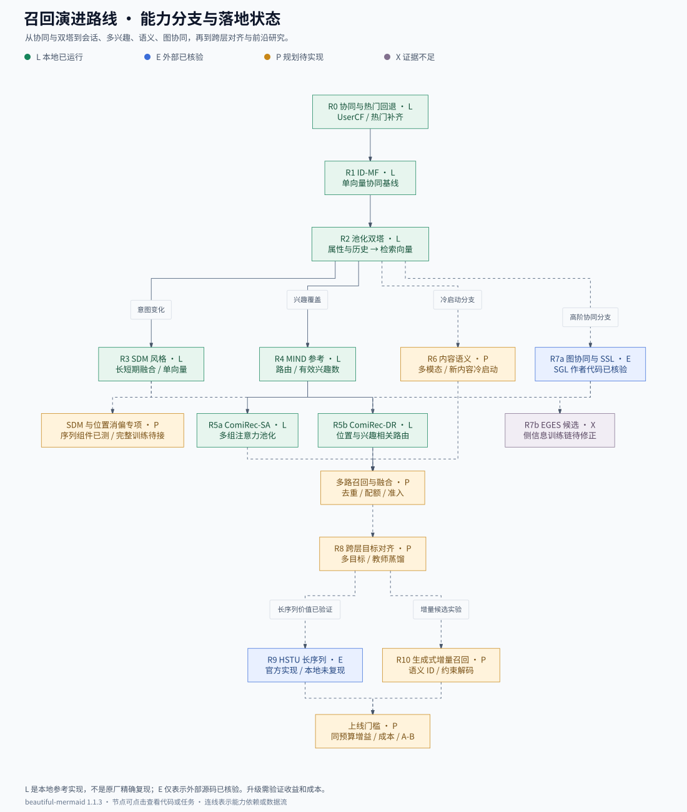

# 召回总入口：路线、收益、核心代码、运行与验收

这是一份工程执行表。每条路线都标记代码是否已经存在、是否实际运行、收益数字的来源，以及下一步交付。**本地已实现六个可训练参考模型**，不是原论文精确复现；已完成的真实训练结果见 [运行报告](BENCHMARK.md)，模型差异与全套命令见 [实现手册](IMPLEMENTATION.md)。

状态：**L**=本地实现并运行；**E**=固定版本外部源码已核验、未在本环境复现；**P**=规划项、核心链路未完成；**X**=来源不明或候选代码不足以支持声称。不能把 E/P/X 标记成已上线。

收益口径：**PUB**=作者公开报告；**RUN**=本仓库合成数据训练实测；**TARGET**=建议立项门槛，待业务确认，不是预测。无真实业务基线时不编造预期线上百分比。

## 1. 完整演进树与依赖

使用 **beautiful-mermaid** 绘制的路线图如下。绿色为本地已运行，蓝色为外部源码已核验，橙色为规划，紫色为证据不足；各节点可在 SVG/离线图册中点击查看代码或任务。



[四图导航与离线图册](diagrams/README.md) · [当前训练与查询数据流](diagrams/02-current-dataflow.svg) · [生产目标数据流](diagrams/03-production-target.svg) · [单向量与多兴趣](diagrams/04-multi-interest-flow.svg)

<details>
<summary>查看文本版演进树</summary>

```text
R0 热门/关注/协同：建立最低可用覆盖与回退
 └─ R1 ID-MF：校验可学习的协同信号
     └─ R2 特征/池化双塔 + 向量检索：主召回基线
         ├─ R3 长短期/会话编码：解决当前意图变化
         ├─ R4 MIND：学习多兴趣，固定上限/有效头数
         │   ├─ R5a ComiRec-SA：注意力池化 + 聚合控制
         │   └─ R5b ComiRec-DR：位置/兴趣变换 + 路由
         ├─ R6 内容语义/多模态：解决新内容与长尾
         └─ R7 图协同：LightGCN/SGL；EGES 是物品图旁路

所有成熟通道 → R8 多目标/精排蒸馏/通道配额与融合
             → R9 可扩展长序列底座/HSTU 与高效检索
             → R10 生成式语义ID作为增量通道，验证后再扩大

横向增强：SE 字段加权；具体 SSL 目标；实时状态与增量索引
持续约束：准入、已看过滤、版本一致、同预算评价、回滚
```

</details>

树表示可选升级和依赖，不是公司必须逐个替换的年代顺序。SDM 与多兴趣解决不同问题，可以并行；图、语义与协同可以长期作为不同通道共存。

## 2. 逐路标执行总表

| 路标 / 状态 | 解决的问题 / 触发条件 | 核心代码，点击可定位 | 收益依据与下一步验收 |
|---|---|---|---|
| R0 UserCF / L，现有服务 | 无稳定模型或需回退 | [`Recommender.recommend`](../../recommender/engine.py#L25) | 既有教学服务可运行；不是工业 ItemCF。先测覆盖、低活/新用户与回退比例 |
| R1 归一化 ID-MF / L | 验证 ID 协同可学习性 | [`MatrixFactorization`](../../recommender/retrieval/models.py#L95) | RUN 见报告；没有通用 MF 收益。作为 ID-only 基线，不承诺正增量 |
| R2 池化双塔 / L | 属性/历史可用，需可部署单向量基线 | [`PooledTwoTower`](../../recommender/retrieval/models.py#L100)、[`ItemTower`](../../recommender/retrieval/models.py#L36) | RUN；不是 Google 原厂复现。TARGET：固定预算较 R1 有增量，校准/冷启动另验 |
| R3 SDM 风格 / L | 当前意图变化、长短期混合 | [`SessionGateRetriever`](../../recommender/retrieval/models.py#L112) | PUB：作者 SDM 混合系统 +10% CTR，不能外推。RUN 另列；TARGET：切换切片改善、整体不退化 |
| R4 MIND 参考 / L | 单向量兴趣覆盖不足 | [`MINDReference`](../../recommender/retrieval/models.py#L216)、[`RoutingReference`](../../recommender/retrieval/models.py#L180) | RUN；未填原论文未核验收益。TARGET：同检索预算有效兴趣覆盖增益，头不过度塌缩 |
| R5a ComiRec-SA 参考 / L | 需要多兴趣且不想用迭代路由 | [`ComiRecSAReference`](../../recommender/retrieval/models.py#L162) | RUN；不保证优于 R4。需位置消融、兴趣贡献、聚合质量与成本评价 |
| R5b ComiRec-DR 参考 / L | 路由及位置相关投影有潜在增量 | [`ComiRecDRReference`](../../recommender/retrieval/models.py#L221)、共享 routing | RUN；不保证优于 SA。需控制投影参数规模、显存及有效候选数 |
| R6 内容语义 / 部分 L + P | 新内容缺协同、长尾覆盖差 | 本地 `ItemTower` 只支持类别特征实验；[编码合同](#r6-内容语义升级合同) | **未实现多模态编码器**。TARGET：零/低曝光内容有效消费改善；语义相似不是消费收益 |
| R7a 图 + SSL / E | 高阶协同/长尾与表征鲁棒性 | [SGL 核心类与 loss](https://github.com/wujcan/SGL/blob/58fe93149ca6fb733639f556343c41f12206ba55/model/general_recommender/SGL.py) | 作者实现已读、未跑；收益待相同图与底座复现，不引用未核验百分比 |
| R7b EGES 物品图 / X | 物品会话图与侧信息融合 | [候选第三方 `EGES.train_step`](https://github.com/wangzhegeek/EGES/blob/2b3763c646524f18bcd129c01296f914c5cfdd01/gpu_process/EGES_module.py) | **该候选不作为忠实复现**：所读训练 loss 仅 Node2Vec，未通过侧信息融合前向；需另找或实现可信版本 |
| R8 蒸馏/多目标融合 / P | 精排好内容在召回缺失、各层目标错位 | 本地扩展点 [`Retriever.loss`](../../recommender/retrieval/models.py#L71)；当前无 KD 实现 | TARGET：固定预算保留最终高价值候选；先扩大教师评分支持集，防止复制偏差 |
| R9 HSTU / E | 长序列的价值已获证据，现有结构成本受限 | [官方 HSTU 核心实现](https://github.com/facebookresearch/generative-recommenders/blob/b8e6ff07c5d4c3354b0807ead76b74d771557fd7/generative_recommenders/research/modeling/sequential/hstu.py) | PUB：ML-1M HR@10 0.2853→0.3097，约 +8.55%；不是短视频收益，large 配置另有容量差异 |
| R10 生成式语义ID / P | 底座、编码和实时内容接入较成熟 | [待实现接口](#r10-生成式增量通道合同)；本轮未定位可承诺复现的原厂核心代码 | 无本项目可靠收益预测。先做 ANN 之外的独有候选贡献，不直接替换全链路 |
| E1 SE / E，组件 | 存在多个有用字段且重要性随用户变化 | [具名实现 `SENETLayer`](https://github.com/shenweichen/DeepCTR/blob/1b5fe40e158d1ee6af8b1d9df217a5ed5aea9136/deepctr/layers/interaction.py#L1067) | 非独立主干；该实现是 ReLU 重权，不要假定 sigmoid。额外参数与服务开销需实测 |
| E2 SSL / E，范式 | 稀疏/噪声表征确有瓶颈 | SGL 的 `create_adj_mat`、`calc_ssl_loss_v2` | SSL 需指定底座/增强/负例；保留维度不代表无训练成本，不保证正收益 |
| X-Rec / X | 原名称无法唯一确认 | [已定位 XRec](https://github.com/HKUDS/XRec/tree/8b73f3f04f6dde71cd1339654b087bac0e2d80d5) 是解释模型 | 不进入动态兴趣召回路线，等待准确标题/链接 |

**SIM 的位置**：它是超长历史 CTR/精排兴趣建模路线，不把“检索用户历史”误记成“全库召回内容”。在召回底座复用类似历史筛选思想时，需要另立新实现和实验，不声称直接复现 SIM 召回主干。

## 3. 本地六个核心模型怎样训练、导出、查询

本地代码入口全部可运行，CPU 环境已验证；核心分类、损失、检索均为实际 PyTorch 计算：

| 任务 | 核心代码 | 产物/约束 |
|---|---|---|
| 模型选择与配置 | [`ModelConfig/build_model`](../../recommender/retrieval/models.py) | 六种明确类名；不依赖原厂 TF1 |
| 时间切分/历史 | [`make_examples/require_global_time_split`](../../recommender/retrieval/experiment.py#L80) | 最后两事件验证/测试，强制全局先后，不通过则拒绝 |
| 正例训练与负例 | [`Retriever.loss`](../../recommender/retrieval/models.py#L71) | 全库 softmax，小目录限定；不是论文 sampled softmax |
| 训练与验证选模 | [`train`](../../recommender/retrieval/experiment.py#L144) | 每轮验证；最佳验证 Recall 的 checkpoint；测试不参与选模 |
| 多兴趣召回打分 | [`Retriever.scores`](../../recommender/retrieval/models.py#L82) | 对有效兴趣取 max，精确全目录检索，不是 ANN |
| 指标 | [`evaluate`](../../recommender/retrieval/experiment.py#L112) | 新颖下一物品；已看过滤；重复目标单独计数 |
| 导出及版本校验 | [`load_export`](../../recommender/retrieval/experiment.py#L211) | checkpoint hash 与索引向量检查，不混用版本 |
| 线上形态的单次查询 | [`query`](../../recommender/retrieval/experiment.py#L226) | 命令行 CPU 查询，非生产 RPC 服务 |
| 全套实验 | [`run_recall_suite`](../../tools/run_recall_suite.py) + [配置](../../configs/recall/cpu-smoke.json) | 6 模型 × 3 训练 seed，数据 seed 固定 |

运行示例：

```bash
python3 -m venv /workspace/recsys-venv
/workspace/recsys-venv/bin/python -m pip install -r requirements-retrieval-cpu.txt
/workspace/recsys-venv/bin/python -m tools.run_recall_suite --output artifacts/recall-fresh
/workspace/recsys-venv/bin/python -m recommender.retrieval.experiment query \
  --checkpoint artifacts/recall-fresh/seed17/session_gate/model.pt \
  --index artifacts/recall-fresh/seed17/session_gate/index.pt \
  --user-id 1 --history 1,2,3 --top-k 10
```

输出目录必须是新的，避免覆盖已有实验。已有环境无需重建；本机虚拟环境已准备好。完整真实数据接入要求、限制和差异见 [实现手册](IMPLEMENTATION.md)。

## 4. 预期收益如何落到一个可以批准的任务

### 4.1 不混用四种数字

1. SDM/HSTU 的 PUB：说明原作者报告了什么，不预测我们能得到多少。
2. 六模型的 RUN：证明代码与实验链路可运行，仅用于合成数据下的行为观察。
3. TARGET：业务批准后可用于 go/no-go，例如“离线有效消费 Recall 相对提升至少 5%、线上主指标不退化、服务成本不超预算”。**5% 是门槛例子，不是这些模型的效果预测。**
4. EXPECTED：真实预期需由当前业务日志的缺口与小流量结果估计；现在缺数据，标记待测，不能拿前三者充当预测。

### 4.2 可计算的预期模型

令 `C0` 为当前有效消费正例覆盖率，`q` 为新路在线下回放中对未覆盖正例的补回比例。相同最终候选预算下的情景估计：

\[
C_1=C_0+(1-C_0)q.
\]

例：**假设** `C0=0.60,q=0.10`，则 `C1=0.64`，绝对增加 4 个百分点、相对 +6.67%。这不是某模型真实预期，因为 q 必须实测，且预算竞争可能挤掉旧候选。

从候选覆盖到线上消费还受粗精排保留、曝光选择、位置和用户反馈影响；不能将 +6.67% Recall 换算成 +6.67% 时长。应使用教师回放、独有高价值候选与小流量实验逐步更新估计，给出区间和失败情景。

### 4.3 按路线批准的收益目标

| 路线 | 预期机制 | 必须填入的业务测量 | 建议验收形式 |
|---|---|---|---|
| 单向量→SDM风格 | 修复当前意图响应 | 兴趣切换损失、状态延迟、会话有效样本 | 切换切片有效召回改善，整体与延迟达标 |
| 单向量→多兴趣 | 修复小众兴趣压缩 | 未覆盖兴趣、头贡献、合并后独有正例 | 同 query/服务预算仍有覆盖增量 |
| SA↔DR | 改善兴趣抽取 | 参数/训练成本、seed 波动、同预算效果 | 不能只用更大投影胜过小模型 |
| 语义/图通道 | 新内容、长尾或高阶协同 | 新内容曝光机会、同质候选重叠、有效消费 | 零/低曝光与总体价值同时评估 |
| 蒸馏 | 补齐后级偏好的候选 | 教师对广候选的可靠评分 | 有效候选增量，不仅教师一致性 |
| HSTU/生成式 | 长历史与候选组织效率 | 等数据/预算曲线、新鲜度与服务成本 | 质量—成本前沿改善，经济门槛通过 |

主指标、最小商业增益、样本量与资源上限必须在实验前填写。没有这些输入，不填写伪精确的“预期 +3%–5%”。经济计算可继续使用 [已提供的收益工具](../recommendation/16-value-and-experiments.md)。

## 5. 每条路线的明确升级任务

### R2 → R3：会话意图

输入：相同 item 表征、用户静态特征、请求前历史。比较池化、衰减池化、固定窗口门控、真实 session 门控；分别检查空会话、长短期冲突、反馈迟到。当前 `session_gate` 只实现固定窗口版本，真实 session 与时间特征仍为下一工作包。

### R2 → R4/R5：多兴趣

固定 K、维度与最终 N 做第一轮；再固定总 query 结果位置数；最后固定端到端资源。记录每头有效贡献、获胜频率、头间相似度、后过滤不足。当前参考实现已经支持多头导出、动态有效头与 max 检索，但还没有 ANN、多样性聚合和生产频控。

### R6 内容语义升级合同

待实现 `ContentEncoder.encode(item_payload)->embedding+encoder_version`，离线编码写特征仓，再作为 `ItemTower` 输入；训练加入 ID dropout 或可靠协同教师对齐；增量内容入索引。验收按发布时间/零曝光切分，不只看已见内容。现有 category 选项只能验证“额外字段如何进入塔”，不能称为视频多模态。

### R7 图通道升级合同

先固定构图窗口、方向、权重与准入；训练只使用时点前图；导出 item 向量后建立 item-to-item 索引，候选标记来源和触发行为。SGL 的用户图与 EGES 的物品图不混为同一个实验。所读第三方 EGES 不满足侧信息端到端损失要求，先修正或替换源码，再开展效益评估。

### R8 跨层协同升级合同

新增广候选教师打分任务，保留任务向量/软顺序与数据时间。向 `Retriever.loss` 增加可选 KD 项，先冻结教师；用旧通道未选区域验证泛化。收益不能只按 teacher Top-K 命中，必须追踪后级价值与曝光结果。

### R9 长序列升级合同

单独建立官方 HSTU 复现环境，先运行其公开配置和同损失 SASRec，再在本业务中固定样本/长度/预算比较；之后才扩长历史。源码可用不等于其 Triton/CUDA 路径已在 CPU 实验环境可跑。

### R10 生成式增量通道合同

待实现 `SemanticTokenizer.fit/encode/version`、`Generator.generate(history,beam)->semantic_ids`、`Resolver.resolve(ids,policy_version)->eligible_items`；需新内容登记、码碰撞与过滤、码本/模型版本配套。保留 ANN 稳定通道，先量化独有候选与解码成本。当前无这三个本地模块，标记 P，不能写已完成。

## 6. 上线前的终点门槛

当前代码的终点是**小目录离线实验与精确查询**。工业上线还需要 sampled loss、分布式稀疏表、ANN、在线特征、实时索引、服务压测、隐私与准入、A/B 和回滚。每条路线必须在总表保留未完成项，不用“核心模型可训练”代替整条生产链路已具备。
