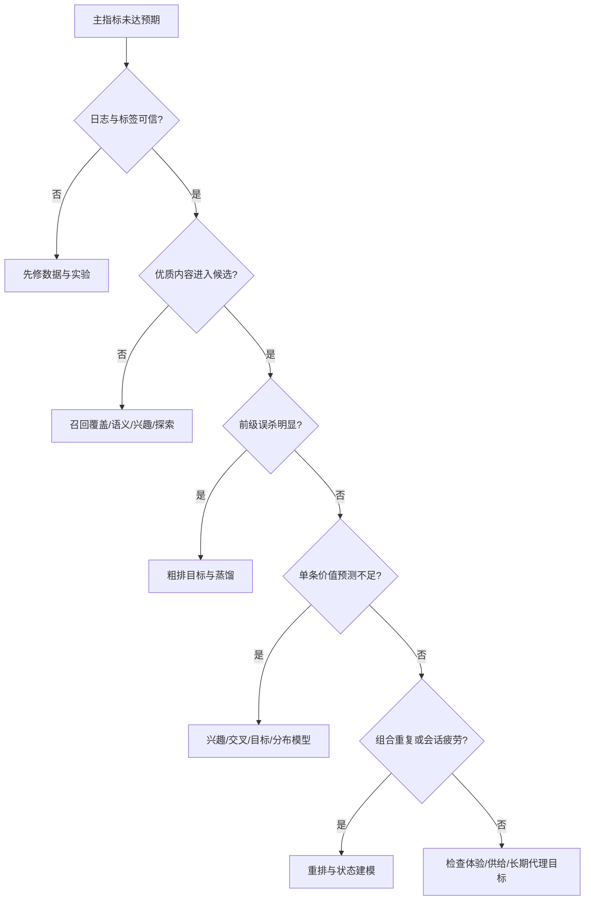

# 17 推荐系统完整技术演进路标树

当前代码完成度及逐节点源码标记已迁移至 [召回执行总表](../recall/README.md)。本章保留技术分类与历史路标，下面关于仅有 A1 教学程序的状态描述属于新增深度参考实现之前的审查记录。

本章回答“从哪里发展而来、现在有哪些并行分支、下一步往哪里走”，而非重复当前模型配置。配套阅读：[召回演进](18-retrieval-evolution.md)、[粗排精排演进](19-ranking-evolution.md)、[重排与基础能力演进](20-decision-feature-evolution.md)、[分场景路线](21-scene-adoption-roadmap.md)。

## 1. 如何阅读这棵树

这是按技术依赖与问题组织的路标树，不是所有公司都会走过的线性年代史。CF、双塔、DIN、规则重排在新模型出现后仍有独立价值；不同层可以处于不同发展阶段。

标记：**成熟基线**=具有广泛公开研究与工程实践，可作为比较起点；**条件采用**=已有成熟技术脉络，但是否值得依业务与平台；**研究验证**=应通过受控实验确认，不能当作所有公司的生产标准。

文中论文名称与年份为代表性公开脉络；最新在线系统状态无法由论文年份推断。[13](13-industry-evidence.md) 才是本项目逐项核验的官方公开实现与数字范围；其余模型名不意味着本轮已经复现或核验原厂代码。

## 2. 完整路标树

```text
推荐系统：可观测、可预测、可决策、可持续
│
├─ A 召回：从相关性检索到用户意图与候选生成
│  ├─ A0 热门/关注/类目/人工规则                         [成熟基线]
│  ├─ A1 协同：UserCF / ItemCF / Swing / 矩阵分解          [成熟基线]
│  ├─ A2 表征：双塔 / sampled softmax / ANN               [成熟基线]
│  │  ├─ A3a 兴趣：会话序列 / 多兴趣 / 长短期              [条件采用]
│  │  ├─ A3b 内容：多模态语义 / 内容-协同对齐 / 冷启动      [条件采用]
│  │  └─ A3c 关系：图表征 / 关注与作者关系                 [条件采用]
│  ├─ A4 跨层：精排蒸馏 / 多目标召回 / 动态通道预算        [条件采用]
│  └─ A5 前沿：生成式语义ID / 大规模序列 / 联合候选生成    [研究验证]
│
├─ B 粗排：从快速筛选到受预算约束的价值保留
│  ├─ B0 规则/轻量统计 → B1 轻量双塔或 DNN               [成熟基线]
│  ├─ B2 少量显式交叉 + 轻量候选相关兴趣                  [条件采用]
│  ├─ B3 精排多任务蒸馏 + 同请求候选顺序学习              [条件采用]
│  └─ B4 共享编码/自适应算力/分层协同                     [研究验证]
│
├─ C 精排：四条相互关联但不应混成一条的演进轴
│  ├─ C1 交叉：LR → FM/FFM → Wide&Deep/DeepFM/DCN
│  │             → 门控/注意力/专家交互                   [成熟→条件]
│  ├─ C2 兴趣：池化 → DIN → DIEN/序列编码
│  │             → 检索式长历史 → 大规模行为序列           [成熟→研究]
│  ├─ C3 目标：CTR → 点击后价值 → 多任务/漏斗
│  │             → 时长分布/负反馈/满意度 → 长期价值        [成熟→研究]
│  └─ C4 范式：点式候选打分 → 请求级共享/target-aware
│                → 序列化/生成式决策                    [条件→研究]
│
├─ D 重排与决策：从局部得分到组合与生态
│  ├─ D0 准入/去重/频控 → D1 MMR/覆盖/约束优化           [成熟基线]
│  ├─ D2 列表交互/位置建模/学习式重排                    [条件采用]
│  ├─ D3 会话状态/疲劳/探索与利用                        [条件采用]
│  └─ D4 长期策略/多主体生态/受约束RL                    [研究验证]
│
├─ E 用户、内容与上下文：从人工统计到统一表征
│  ├─ E0 离线属性/统计 → E1 稀疏Embedding/显式交叉        [成熟基线]
│  ├─ E2 多行为序列/实时状态/长期记忆                    [条件采用]
│  ├─ E3 多模态编码/结构化语义/教师蒸馏                  [条件采用]
│  └─ E4 共享行为-内容基础表征/记忆与反馈闭环              [研究验证]
│
└─ F 训练、服务与评估：决定上述路线能否落地
   ├─ F0 时点正确数据/时间切分/统一曝光口径               [必需基础]
   ├─ F1 周期训练/特征服务/ANN/版本发布                   [成熟基线]
   ├─ F2 流式状态/参数生命周期/增量索引/分布式训练         [条件采用]
   ├─ F3 请求内复用/jagged/量化/kernel/蒸馏              [条件采用]
   └─ F4 质量-成本-新鲜度联合扩展/可靠长期实验             [持续方向]
```

## 3. 代表性历史锚点：避免“新模型替换旧模型”的误读

| 公开脉络 | 推动的问题 | 不能推导的结论 |
|---|---|---|
| 早期 CF、矩阵分解、LR/FM | 从规则匹配到协同偏好与稀疏交互 | CF 已经没有用途 |
| 2010 年代中后期，深度候选生成与 Wide & Deep/DeepFM/DCN | 可扩展表征、显式与隐式交叉 | 使用 DNN 就不再需要特征工程 |
| DIN、DIEN、SASRec，2018–2019 前后 | 候选相关兴趣与序列依赖 | 所有行为都应放入同一个序列 |
| ESMM、MMoE、PLE，2018–2020 前后 | 选择性标签、任务关系与负迁移 | 多任务天然优于单任务 |
| MIND、ComiRec、SIM，2019–2020 前后 | 多兴趣压缩与长历史成本 | 多兴趣数越大越好 |
| 2020 年代，实时学习、多模态与复杂多目标持续发展 | 新鲜度、内容冷启动、观看价值与生态 | 全行业已统一使用同一方案 |
| TIGER 2023、HSTU 2024 及公开实现后续扩展 | 语义ID生成、大规模序列与计算协同 | 生成式模型已经普遍替代分层推荐 |

这里的顺序是代表性技术出现的脉络，不表示各能力始于这些论文；例如多目标、序列与探索都有更早研究。

## 4. 当前状态与未来目标的区别

本仓库当前可运行部分处于 A1 的小规模用户协同原型，未实现工业级 A2/B/C/D。09–11 是实现蓝图；12–16 是研究与生产评审；本章及后续章节是完整路线图。不能把“文档覆盖到 A5”解释为“系统已经具备 A5”。

合理的目标不是所有节点都达到最右端，而是在数据、延迟、成本与体验约束下形成有效组合。列表页可能长期保留 DIN + 多任务 + 约束重排，视频流在相同平台上优先发展实时会话与时长分布。

## 5. 演进决策树



## 6. 所有分支共同的升级门槛

每一次升级都要回答：旧方案在哪个切片失败；新机制怎样修复；新增成本多少；是否在匹配预算下改善；线上与长期护栏是否通过。具体经济与实验规则见 [16](16-value-and-experiments.md)。
