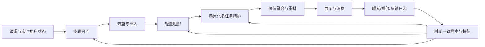

# 信息流与短视频推荐：分层模型设计

面向算法负责人和模型研发人员的设计文档。重点解释模型在什么问题上有效、训练信号如何构造、在线如何计算，以及在哪些情况下失效。

本文基于公开技术脉络与通用工程经验，不声称复原任何公司的当前生产架构，也不是对最新论文的穷尽调查。文中维度、窗口、候选量均为设计示例，应通过数据分布、容量评估与实验确定。当前仓库的 Python 协同过滤程序是教学原型，尚未实现本文的深度模型。

## 评审入口：先判断能否落地，再选择模型

需要完整技术发展路线时，从 [17 演进路标树](17-evolution-roadmap-tree.md) 开始，再读 [18 召回](18-retrieval-evolution.md)、[19 粗排与精排](19-ranking-evolution.md)、[20 重排/特征/训练评估](20-decision-feature-evolution.md) 和 [21 分场景推进](21-scene-adoption-roadmap.md)。这些章节区分历史脉络、并行分支、当前成熟能力与未来研究方向。

现有方案仍有生产缺口；请优先阅读 [12 落地审查](12-readiness-review.md)、[13 已核验证据](13-industry-evidence.md)、[14 生产执行](14-production-execution.md)、[15 前沿规划](15-frontier-portfolio.md) 和 [16 收益与实验](16-value-and-experiments.md)。其中区分官方实现、公开报告、本项目假设及尚未完成的工程，避免把模型结构设计当成生产完成证明。

## 阅读顺序

| 文档 | 核心问题 |
|---|---|
| [01 场景与目标](01-scenarios-objectives.md) | 列表页和视频流的监督信号、概率口径、价值目标有何区别 |
| [02 召回模型](02-retrieval.md) | 双塔、序列、多兴趣、内容冷启动如何训练与服务 |
| [03 粗排与蒸馏](03-preranking.md) | 如何在严格预算中减少误杀，缩小粗精排差异 |
| [04 列表页精排](04-feed-ranking.md) | 特征交叉、候选相关兴趣、点击与消费漏斗、多任务模型 |
| [05 视频流精排](05-video-ranking.md) | 时长分布、快划、长度偏差、长序列和会话建模 |
| [06 重排与探索](06-reranking-exploration.md) | 列表级优化、连续疲劳、探索、长期价值 |
| [07 特征与训练](07-features-training.md) | 用户、内容、上下文、交叉特征和时间一致的数据闭环 |
| [08 实施与参考](08-roadmap-references.md) | 如何组合模型、开展实验，以及可追溯的公开资料 |
| [09 召回实现蓝图](09-retrieval-blueprint.md) | 双塔与多兴趣的逐层维度、批内负例、梯度与索引 |
| [10 列表页模型实现蓝图](10-feed-model-blueprint.md) | DIN + DCN + MMoE/PLE 的张量接口、漏斗损失与推理 |
| [11 视频流模型实现蓝图](11-video-model-blueprint.md) | 会话编码、hazard 似然、完播/删失/复播的统一口径 |
| [12 落地审查与反思](12-readiness-review.md) | 当前缺口、模型设计修正、数据依赖与上线门槛 |
| [13 可信业界证据](13-industry-evidence.md) | 固定提交源码、公开结果、可迁移与不可外推边界 |
| [14 生产架构与执行](14-production-execution.md) | 服务合同、容量预算、版本发布、角色与阶段产物 |
| [15 前沿研究组合](15-frontier-portfolio.md) | HSTU、多模态、生成式召回、长期优化的 go/no-go |
| [16 收益与实验](16-value-and-experiments.md) | 经济门槛、功效、情景测算工具和放量决策 |
| [17 完整演进路标树](17-evolution-roadmap-tree.md) | 六条主线、精排四轴、历史脉络与升级决策树 |
| [18 召回发展路标](18-retrieval-evolution.md) | 协同→双塔→序列/多兴趣/语义→蒸馏与生成式 |
| [19 粗排精排发展路标](19-ranking-evolution.md) | 交叉、兴趣、目标、计算范式的独立演进及协同 |
| [20 决策与基础能力路标](20-decision-feature-evolution.md) | 重排、探索、特征、训练服务与评估闭环 |
| [21 分场景采用路线](21-scene-adoption-roadmap.md) | 列表页/视频流分阶段目标、依赖、交付与退出条件 |

需要模型实现细节时优先阅读 09–11；01–08 提供各层职责、场景差异与方案选择背景。蓝图中的伪代码用于解释算法，尚未作为可执行训练程序交付。

## 统一记号

- \(u,i,c\)：用户、候选内容、请求上下文；\(H_u\) 是请求时可获得的历史。
- \(E,C,Q,A\)：可见曝光、点击、有效消费、互动事件。不同场景的事件定义见第一章。
- \(T,D\)：观看或阅读时长、内容长度。视频复播时 \(T\) 可以超过 \(D\)。
- \(h\in\mathbb R^d\)：隐藏表征；\(p_t\) 为任务概率；\(\operatorname{sg}\) 表示停止梯度。
- 所有概率均应明确条件集；“曝光”默认是真正可见曝光，不等于接口下发。

## 设计总览

多层模型不是独立优化即可得到整体最优：召回决定可选择范围，粗排决定精排的支持集，精排决定价值预测，重排决定实际体验。评价某一层应同时检查其本层指标与对最终分发的增量贡献。
