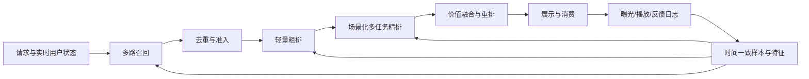

# 信息流与短视频推荐：分层模型设计

面向算法负责人和模型研发人员的设计文档。重点解释模型在什么问题上有效、训练信号如何构造、在线如何计算，以及在哪些情况下失效。

本文基于公开技术脉络与通用工程经验，不声称复原任何公司的当前生产架构，也不是对最新论文的穷尽调查。文中维度、窗口、候选量均为设计示例，应通过数据分布、容量评估与实验确定。当前仓库的 Python 协同过滤程序是教学原型，尚未实现本文的深度模型。

## 阅读顺序

| 文档 | 核心问题 |
|---|---|
| [01 场景与目标](01-scenarios-objectives.md) | 列表页和视频流的监督信号、概率口径、价值目标有何区别 |
| [02 召回模型](02-retrieval.md) | 双塔、序列、多兴趣、内容冷启动如何训练与服务 |
| [03 粗排与蒸馏](03-preranking.md) | 如何在严格预算中减少误杀，缩小粗精排差异 |
| [04 列表页精排](04-feed-ranking.md) | 特征交叉、候选相关兴趣、点击与消费漏斗、多任务模型 |
| [05 视频流精排](05-video-ranking.md) | 时长分布、快划、长度偏差、长序列和会话建模 |
| [06 重排与探索](06-reranking-exploration.md) | 列表级优化、连续疲劳、探索、长期价值 |
| [07 特征与训练](07-features-training.md) | 用户、内容、上下文、交叉特征和时间一致的数据闭环 |
| [08 实施与参考](08-roadmap-references.md) | 如何组合模型、开展实验，以及可追溯的公开资料 |

## 统一记号

- \(u,i,c\)：用户、候选内容、请求上下文；\(H_u\) 是请求时可获得的历史。
- \(E,C,Q,A\)：可见曝光、点击、有效消费、互动事件。不同场景的事件定义见第一章。
- \(T,D\)：观看或阅读时长、内容长度。视频复播时 \(T\) 可以超过 \(D\)。
- \(h\in\mathbb R^d\)：隐藏表征；\(p_t\) 为任务概率；\(\operatorname{sg}\) 表示停止梯度。
- 所有概率均应明确条件集；“曝光”默认是真正可见曝光，不等于接口下发。

## 设计总览

多层模型不是独立优化即可得到整体最优：召回决定可选择范围，粗排决定精排的支持集，精排决定价值预测，重排决定实际体验。评价某一层应同时检查其本层指标与对最终分发的增量贡献。
